

  

<!-- Each SVG is an editable, independently linked navigation tile. -->

  <a href="https://github.com/illescasDaniel?tab=repositories">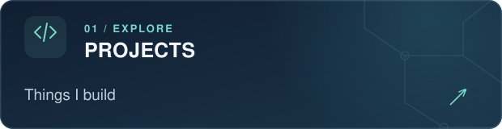</a><a href="#agent-skills">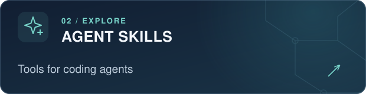</a> 
  <a href="https://www.daniel-ir.eu/">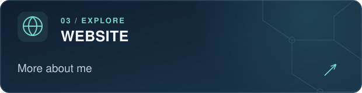</a><a href="https://www.daniel-ir.eu/blog">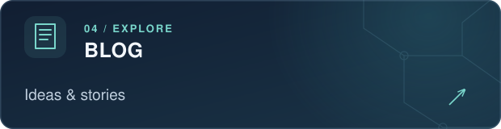</a>

## 👋 About me

I'm a native mobile and backend developer from Madrid with nearly a decade of experience building frictionless, user-centric software. My day job is iOS (Swift, SwiftUI, UIKit, Clean/Hexagonal architectures, heavy on testing and CI/CD), and I'm just as comfortable owning the server side with Python and FastAPI. I hold a Master's degree in Artificial Intelligence, and lately most of my open-source time goes into tooling that makes coding agents more reliable: project memory, documentation, spec-driven workflows and code-navigation MCP servers. I've also shipped 4 self-published App Store apps with 100,000+ organic downloads, including Code Reader, a privacy-focused QR and barcode scanner I've maintained for almost ten years.

  
  
  
  
  
  
  

---

##  Agent Skills

Reusable skills for coding agents (Claude Code, Cursor, Codex), each in its own repo with install instructions.

<!-- Repository cards are individually editable SVGs. -->

  <a href="https://github.com/illescasDaniel/memory-1-skill">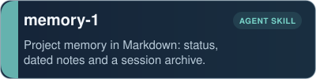</a><a href="https://github.com/illescasDaniel/docs-1-skill">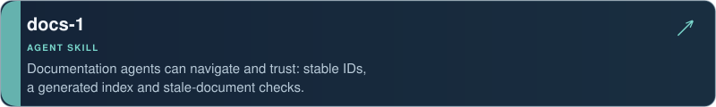</a> 
  <a href="https://github.com/illescasDaniel/sdd-html-feature-skill">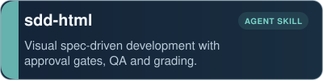</a>

---

##  MCP servers (code navigation)

Compiler-accurate code navigation for agents, so they find symbols and references instead of grepping.

  <a href="https://github.com/illescasDaniel/codenav-mcp">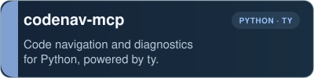</a><a href="https://github.com/illescasDaniel/webnav-ts-mcp">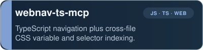</a> 
  <a href="https://github.com/illescasDaniel/codenav-swift-mcp">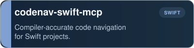</a><a href="https://github.com/illescasDaniel/codenav-go-mcp">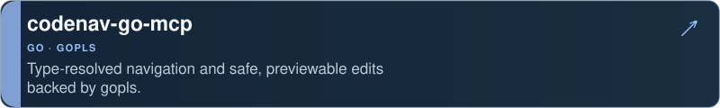</a>

---

##  Python projects

  <a href="https://github.com/illescasDaniel/wdict">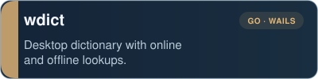</a><a href="https://github.com/illescasDaniel/agentic-loadout">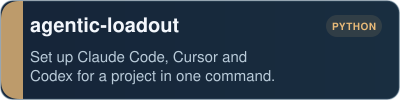</a> 
  <a href="https://github.com/illescasDaniel/srxy">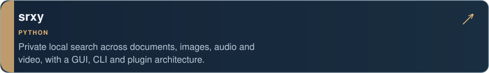</a><a href="https://github.com/illescasDaniel/SpaceMaker">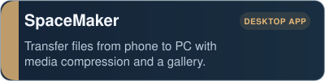</a>

---

##  iOS projects

  <a href="https://github.com/illescasDaniel/GamesLibrary-sample-app">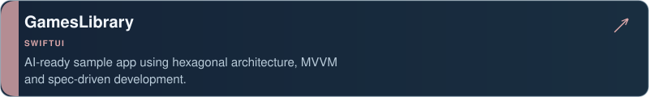</a><a href="https://github.com/illescasDaniel/SwiftBeans">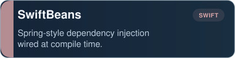</a> 
  <a href="https://github.com/illescasDaniel/astk">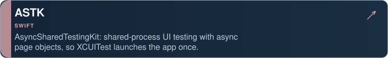</a><a href="https://github.com/illescasDaniel/TTLCache">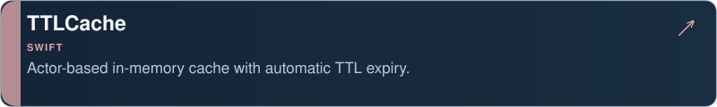</a> 
  <a href="https://github.com/illescasDaniel/Questions">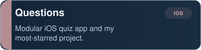</a>

---

  <a href="https://github.com/illescasDaniel?tab=repositories">All repositories →</a>

